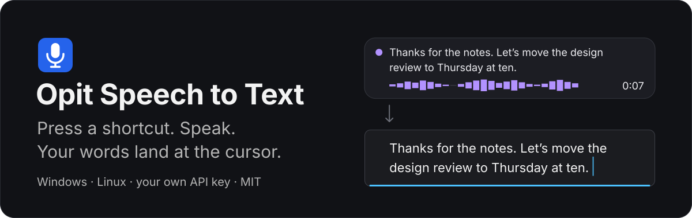
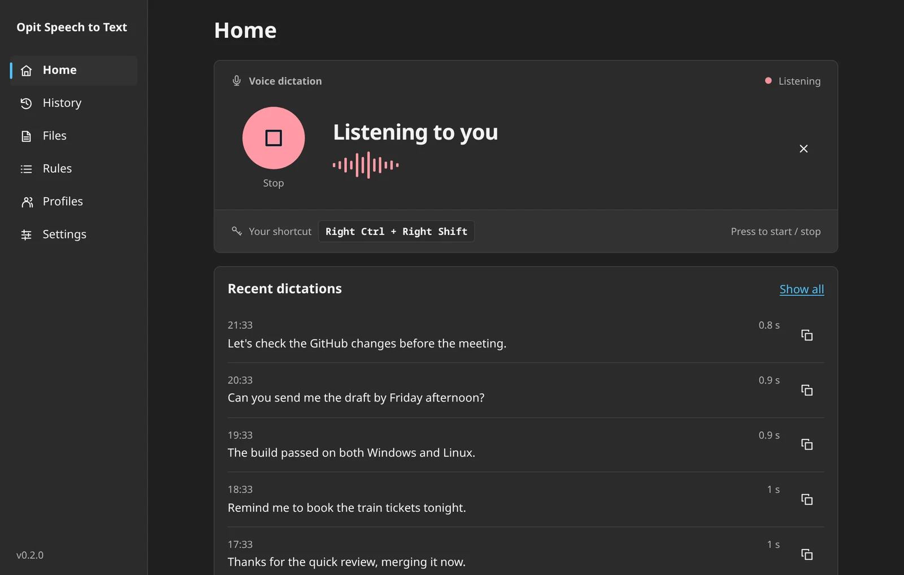
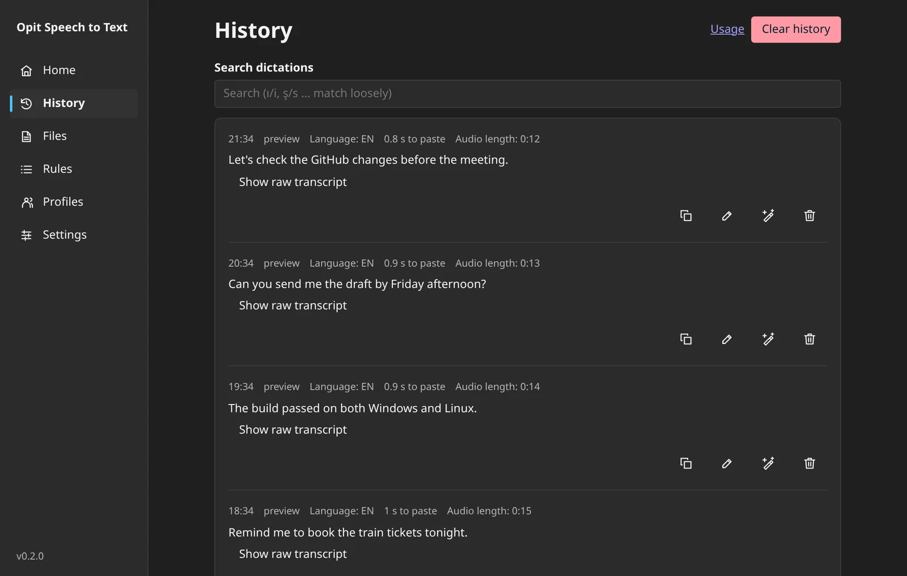
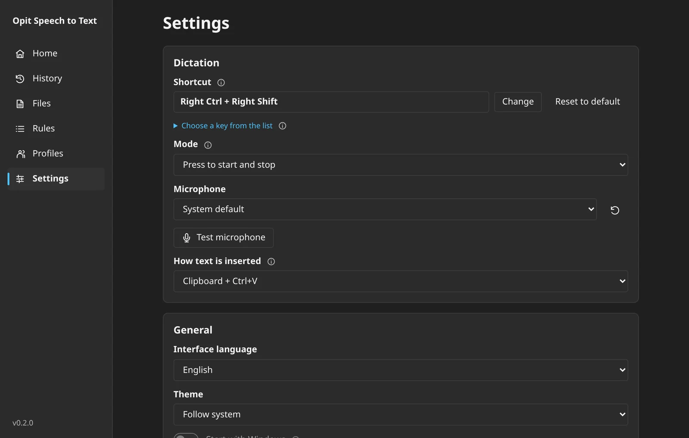

<p align="center">
  
</p>

<p align="center">
  <a href="https://github.com/opit80/opit-speech-to-text/releases/latest"></a>
  <a href="https://github.com/opit80/opit-speech-to-text/actions/workflows/ci.yml"></a>
  
  <a href="LICENSE"></a>
</p>

<p align="center">
  <a href="https://github.com/opit80/opit-speech-to-text/releases/latest"><b>Download</b></a> ·
  <a href="docs/guides/using-the-app.md">User guide</a> ·
  <a href="docs/README.md">Documentation</a> ·
  <a href="docs/releases/0.2.0.md">What's new in 0.2.0</a>
</p>

---

**Opit Speech to Text** is an open-source voice dictation app for Windows and Linux. It sits in
the tray: press a shortcut, speak, and the text is typed where your cursor is, in any app.
Transcription runs on **your own API key** (ElevenLabs, Groq, OpenAI, Deepgram or any
OpenAI-compatible server), so there is no account, no subscription and no server of ours in
between.

<p align="center">
  
</p>

## How it works

1. **Press** your shortcut. A small panel shows the waveform, the elapsed time and, if you
   turn it on, a live preview of what you are saying.
2. **Speak**. Music and videos playing in other apps are turned down until you finish.
3. **Press again**. The audio goes to the provider you chose and the text is pasted at your
   cursor. It also stays on the clipboard and in your local history.

## Download

| Platform | File | Notes |
|---|---|---|
| Windows 10 / 11 (x64) | `opit-speech-to-text_<version>_x64-setup.exe` | Per-user install, no admin prompt. Not code-signed yet, so SmartScreen may ask you to confirm. |
| Linux (x86_64), any distro | `opit-speech-to-text_<version>_amd64.AppImage` | `chmod +x` and run. |
| Debian / Ubuntu (amd64) | `opit-speech-to-text_<version>_amd64.deb` | `sudo apt install ./opit-speech-to-text_<version>_amd64.deb` pulls in the dependencies. |

All files are on the [latest release](https://github.com/opit80/opit-speech-to-text/releases/latest),
together with `SHA256SUMS`. The Windows installer and the AppImage update themselves from inside
the app, and only accept an update whose signature matches the key built into it; the deb is
updated by installing the newer package. A setup wizard opens on the first start and walks you
through language, provider, microphone and shortcut.

> [!NOTE]
> **Your key, your provider, your data.** Audio goes only to the transcription provider you
> pick (and its fallback, if you set one). Text goes to an AI service only when you turn on AI
> cleanup, Ask or translation. API keys live in the system credential store (Windows Credential
> Manager, or the Secret Service on Linux), never in a file. History stays on your computer.
> There is no telemetry, and the update check can be turned off.

## Features

- **Dictate anywhere.** One global shortcut, toggle or push-to-talk on Windows; the text is
  pasted at the cursor or kept on the clipboard.
- **Pick your engine.** Presets for ElevenLabs Scribe v2, Groq Whisper, OpenAI, Deepgram Nova-3
  and any OpenAI-compatible server, with an optional fallback profile. Offline local models are
  available on Windows.
- **AI cleanup.** Optional punctuation and wording cleanup with styles, through Google AI Studio,
  OpenRouter, Groq, OpenAI, DeepSeek, Baseten, a local server (for example Ollama) or your own
  endpoint. It turns itself on once a saved key passes its connection test.
- **Voice commands.** Separate shortcuts to ask a question, dictate straight into another
  language, or (on Windows) rewrite the selected text by voice.
- **Quiet media.** Playing audio is lowered while you record (or paused, if you prefer) and
  restored afterwards.
- **History you can search.** Every dictation is stored locally with loose Turkish matching
  (`ı`/`i`, `ş`/`s`), copy, retry and optional audio, plus usage statistics.
- **Files too.** Transcribe audio or video files to text or SRT from the Files page or the
  `opit` command line.
- **Your words, your rules.** Personal corrections and terminology in a simple `user.yaml`, and
  number spelling for Turkish and English.
- **English and Turkish** interface, light and dark themes, and signed in-app updates.

<p align="center">
  
  
</p>

## Providers

| Transcription | Default model | AI cleanup | Default model |
|---|---|---|---|
| ElevenLabs Scribe v2 (recommended) | `scribe_v2` | Google AI Studio | `gemini-3.5-flash-lite` |
| Groq | `whisper-large-v3` | OpenRouter | `google/gemini-2.5-flash-lite` |
| OpenAI | `gpt-transcribe` | Groq | `llama-3.1-8b-instant` |
| Deepgram | `nova-3` | OpenAI | `gpt-4.1-mini` |
| Local, offline (Windows) | `ggml-large-v3-turbo-q5_0` | DeepSeek, Baseten, local server | see [AI cleanup](docs/guides/ai-cleanup.md) |
| Any OpenAI-compatible server | your choice | Any OpenAI-compatible server | your choice |

## Platform notes

**Windows.** Any key or combination can be the shortcut, captured by pressing it; push-to-talk
and Esc-to-cancel work everywhere. The app starts with Windows once setup is finished.

**Linux.** Shortcuts are registered with the desktop itself, so they work on Wayland without
reading your keyboard: KDE Plasma and GNOME are set up automatically from Settings, other X11
desktops use a native grab, and on other Wayland desktops you bind the shown command yourself.
Linux shortcuts toggle (there is no push-to-talk). Text is typed through the desktop's Remote
Desktop portal, with `ydotool` and the clipboard as fallbacks. Media ducking uses `pactl`.
Tested on KDE Plasma 6 (Wayland); GNOME and X11 are implemented but not yet verified on a real
desktop. See [Linux shortcuts](docs/guides/linux-shortcuts.md).

## Command line

The `opit` tool controls the running app and works with your stored settings:

```sh
opit toggle                                   # start or stop a dictation
opit transcribe meeting.mp3 --srt -o meeting.srt
opit history list --limit 5
```

It ships with the app (`/usr/bin/opit` in the deb). See the [CLI guide](docs/guides/cli.md).

## Documentation

- [User guide](docs/guides/using-the-app.md): setup, pages, settings, data folders, updates and uninstalling
- [AI cleanup](docs/guides/ai-cleanup.md) · [Voice modes](docs/reference/voice-modes.md) · [File transcription](docs/guides/file-transcription.md) · [Local transcription](docs/guides/local-transcription.md)
- [Linux status](docs/development/linux-status.md) and [known issues](docs/development/known-issues.md)
- [All documentation](docs/README.md)

## Building from source

Rust 1.90+, Node 24 and Tauri CLI 2.12.0. On Linux you also need the GTK/WebKit development
packages listed in the guide.

```sh
cd ui && npm ci && cd ..
cargo tauri dev        # run with the Vite dev server
cargo test --workspace
```

Full instructions, the browser preview and the Linux gate are in
[Building](docs/development/building.md); maintainers release with
[Releasing](docs/release/RELEASING.md).

## Contributing

Issues and pull requests are welcome; read [CONTRIBUTING.md](CONTRIBUTING.md) first. Report
security problems privately as described in [SECURITY.md](SECURITY.md).

## License

[MIT](LICENSE) © opit80
